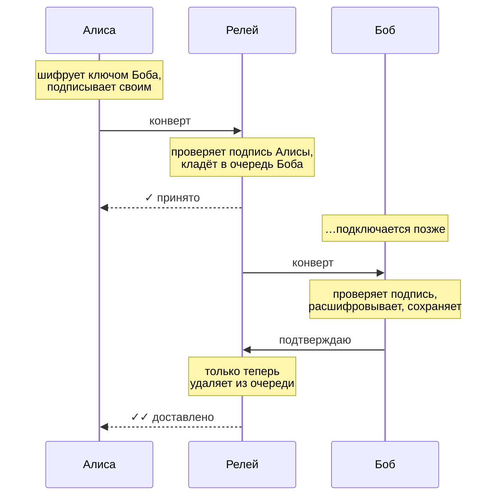

# messanger

Маленькое ядро мессенджера со сквозным шифрованием, написанное на Rust.

Идея простая: **сервер не должен уметь читать ваши сообщения.** Он работает как почта,
которая передаёт запечатанные конверты: видит, от кого и кому письмо, но не знает, что внутри.
Всё шифрование происходит на ваших устройствах, а ключи никогда их не покидают.

Сейчас здесь есть всё, на чём держится мессенджер: ключи, шифрование, подписи,
локальная база с историей, сервер-релей и консольный клиент, чтобы всё это пощупать руками.
Красивого интерфейса и мобильного приложения пока нет, но фундамент для них готов и покрыт тестами.

> [!WARNING]
> **Это экспериментальный проект.** Криптография собрана из хорошо изученных примитивов
> (X25519, Ed25519, ChaCha20-Poly1305), но сама схема не проходила независимый аудит.
> Пожалуйста, не доверяйте ему ничего, из-за чего у вас могут быть настоящие неприятности.
> Ниже честно написано, [от чего он защищает, а от чего нет](#что-защищено-а-что-нет).

---

## Попробовать за пять минут

Понадобится Rust 1.85 или новее ([установить](https://rustup.rs)).

```sh
git clone https://github.com/Paustovskiy/messanger.git
cd messanger
cargo build --release
```

Получатся две программы в `target/release/`:

- `messenger-relay` — сервер, который передаёт сообщения;
- `messenger` — клиент.

Устроим переписку Алисы и Боба на одном компьютере. Каждому нужен свой **профиль** —
это отдельная база со своими ключами.

**Терминал 1 — запускаем релей:**

```sh
./target/release/messenger-relay
```

**Терминал 2 — Алиса:**

```sh
alias alice='./target/release/messenger --profile alice'

alice init
alice set-username alice
alice export-contact -o alice.json
```

```
Создана новая личность для профиля `alice`.
account_id: 0d71b6a2e1e5797b69fd141e4ac49274
отпечаток:  89b1 8cf9 50f2 050c 5b20 2e44 6d84 14c0 bf1d ac08
```

**Терминал 3 — Боб:** то же самое.

```sh
alias bob='./target/release/messenger --profile bob'

bob init
bob set-username bobby
bob export-contact -o bob.json
```

### Знакомимся

Чтобы написать человеку, нужна его **карточка контакта**: небольшой JSON с публичными ключами.
Она не секретная, её можно переслать чем угодно.

```sh
alice add-contact --contact-file bob.json
bob add-contact --contact-file alice.json
```

```
Контакт сохранён: @bobby
отпечаток: 2b1a fd62 a84d 6d8f 7a2c 3e4d cc98 be9c 260d 1a5c
Сверьте его с тем, что собеседник видит в `messenger whoami` (голосом или при встрече).
```

Тот самый **отпечаток** — главное, что стоит проверить. Если он совпадает с тем,
что Боб видит у себя в `bob whoami`, значит, карточку по дороге никто не подменил.
Это как сверить номер паспорта: занимает десять секунд, но без этого остальная защита
держится на честном слове.

### Переписываемся

Боб пока не в сети. Алиса всё равно пишет:

```sh
alice send @bobby "Привет! Ты тут?"
```

```
✓  отправлено: @bobby
   собеседник не в сети — релей доставит, как только он подключится
```

Боб выходит в сеть и сразу получает то, что его ждало:

```sh
bob listen
```

```
В сети как @bobby (ws://127.0.0.1:8080/ws). Ctrl+C — выйти.
[12:39] @alice: Привет! Ты тут?
```

Теперь, когда Боб онлайн, сообщения доходят мгновенно, а Алиса видит две галочки:

```sh
alice send @bobby "Вижу, что дошло 🙂"
```

```
✓✓ доставлено @bobby: «Привет! Ты тут?»
✓  отправлено: @bobby
✓✓ доставлено @bobby: «Вижу, что дошло 🙂»
```

История и список диалогов:

```sh
alice chat @bobby
bob threads
```

```
[2026-10-21 12:39] я ✓✓: Привет! Ты тут?
[2026-10-21 12:39] я ✓✓: Вижу, что дошло 🙂

[2026-10-21 12:39] @alice (2 новых) — Вижу, что дошло 🙂
```

Галочки значат то же, что и везде: **✓** — сообщение принято сервером,
**✓✓** — собеседник получил его и сохранил у себя.

---

## Как это работает, простыми словами

### Два ключа на человека

При `init` клиент создаёт две пары ключей:

- **ключ шифрования (X25519)** — с его помощью вам можно зашифровать письмо, которое откроете только вы;
- **ключ подписи (Ed25519)** — им вы «расписываетесь» под своими сообщениями, чтобы никто не мог писать от вашего имени.

Секретные половинки остаются в вашей локальной базе. В карточку контакта попадают только публичные.

Ваш `account_id` не случайный: он вычисляется из ключа подписи. Это пригодится чуть ниже.

### Путь одного сообщения



Для каждого письма Алиса придумывает одноразовый ключ, вместе с ключом Боба получает
из него общий секрет и шифрует текст. Открыть конверт может только Боб.
Отправитель и получатель «вшиты» в шифр: если кто-то попробует переписать адрес на конверте,
письмо просто перестанет открываться.

### Сообщения не теряются

Релей хранит сообщение на диске, пока получатель **не подтвердит**, что сохранил его у себя.
Отвалился интернет на середине доставки, перезапустили сервер — не беда: при следующем
подключении письмо придёт снова. А клиент узнаёт уже полученные сообщения по их идентификатору
и не показывает их дважды.

Исходящее сообщение тоже сначала сохраняется у вас, и только потом уходит в сеть.
Если релей недоступен, оно подождёт в «исходящих» и уйдёт при следующем `listen`
или `retry-outbox`.

### Никто не зайдёт под вашим именем

Когда клиент подключается к релею, тот присылает случайное число, а клиент подписывает его
своим ключом. Так как `account_id` вычислен из этого же ключа, релей сразу видит, что ID и ключ
подходят друг к другу. Поэтому прочитать вашу очередь сообщений, просто назвавшись вами,
не получится, даже если вы ещё ни разу не подключались.

Если хочется подробностей вплоть до байтов, загляните в [`docs/PROTOCOL.md`](docs/PROTOCOL.md).

---

## Что защищено, а что нет

Честный список, без маркетинга.

| Ситуация | Что будет |
|---|---|
| Сервер или кто-то в сети хочет прочитать переписку | ✅ **Не выйдет.** Текст зашифрован на устройстве отправителя |
| Кто-то подменил текст сообщения по дороге | ✅ **Заметим.** Подпись не сойдётся, и сообщение будет отброшено |
| Кто-то пишет вам от имени Алисы | ✅ **Не выйдет** без секретного ключа Алисы |
| Кто-то подключается к релею под вашим ID, чтобы забрать вашу почту | ✅ **Не пустят.** Нужна подпись вашим ключом |
| Чужая карточка с тем же `@username`, что у вашего контакта | ✅ **Не примем.** Username не может перейти к другому аккаунту молча |
| Кто-то подменил карточку при первом обмене | ⚠️ **Спасает только сверка отпечатков.** Не пропускайте её |
| Сервер видит, **кто, кому и когда** пишет, и примерный размер писем | ⚠️ **Да, видит.** Это метаданные, их почтальон знает всегда |
| Сеть видит то же самое, плюс ваш ID | ⚠️ Если подключаться по `ws://`. **Используйте `wss://`** (см. ниже) |
| Ваш секретный ключ украли, а у вора была запись старой переписки | ❌ **Он сможет её прочитать.** Прямой секретности (как в Signal) пока нет |
| Украли сам компьютер | ❌ База с ключами **не зашифрована паролем.** Защищена только правами доступа ОС (`600`) |
| Сервер «теряет» или задерживает сообщения | ⚠️ Помешать нельзя, но **вы это увидите:** вторая галочка не появится |

---

## Все команды

| Команда | Что делает |
|---|---|
| `init` | Создать свою личность (один раз на профиль) |
| `whoami` | Показать свой ID, username и отпечаток |
| `set-username <имя>` | Задать `@username`: 5–32 символа `a–z`, `0–9`, `_`, начинается с буквы |
| `export-contact [-o файл]` | Выгрузить свою карточку контакта |
| `add-contact` | Добавить собеседника: `--contact '<json>'`, `--contact-file <путь>` или через stdin |
| `list-contacts` | Контакты с их отпечатками |
| `remove-contact <кто>` | Удалить контакт |
| `send <кому> <текст>` | Отправить через релей. `--offline` вместо этого выведет зашифрованный конверт |
| `receive` | Открыть конверт, полученный в обход релея (например, по почте или на флешке) |
| `listen` | Быть в сети: получать сообщения, досылать исходящие, переподключаться при обрыве |
| `retry-outbox` | Дослать всё, что ещё не доставлено, и выйти |
| `chat <с кем>` | История переписки |
| `threads` | Список диалогов с непрочитанными |

«Кому» и «с кем» можно указывать как `@username` (собачку можно опустить) или как `account_id`.

### Настройки

| Параметр | Переменная окружения | По умолчанию |
|---|---|---|
| `--profile <имя>` | `MESSENGER_PROFILE` | `messenger` |
| `--relay <url>` | `MESSENGER_RELAY` | `ws://127.0.0.1:8080/ws` |
| `--db <путь>` | `MESSENGER_DB` | каталог данных ОС, например `~/.local/share/<профиль>/` |

Например, чтобы не писать адрес релея каждый раз:

```sh
export MESSENGER_RELAY=wss://chat.example.com/ws
```

---

## Свой релей на сервере

Релей — одна программа без внешних зависимостей. Всё состояние живёт в одном файле SQLite.

```sh
messenger-relay --bind 127.0.0.1:8080 --db /var/lib/messenger/relay.sqlite
```

| Флаг | Смысл | По умолчанию |
|---|---|---|
| `--bind` | Адрес и порт (`RELAY_BIND`) | `127.0.0.1:8080` |
| `--db` | Файл базы (`RELAY_DB`) | `relay.sqlite` |
| `--in-memory` | Ничего не сохранять на диск (для экспериментов) | выкл. |
| `--ttl-days` | Сколько дней хранить недоставленные сообщения | `30` |
| `--max-queue` | Сколько сообщений может ждать одного получателя | `1000` |

Подробность логов — через `RUST_LOG`, например `RUST_LOG=debug`. В логи попадают только
ID аккаунтов, содержимое сообщений релей не видит в принципе.
По `SIGTERM` и Ctrl+C релей завершается аккуратно, так что подходит для systemd и Docker.
Для проверки «жив ли» есть `GET /health`.

**Про TLS.** Сам релей шифрованное соединение не поднимает: эту работу лучше отдать
обратному прокси. Проще всего с [Caddy](https://caddyserver.com), он сам получит сертификат:

```
chat.example.com {
    reverse_proxy 127.0.0.1:8080
}
```

После этого клиенты подключаются через `--relay wss://chat.example.com/ws`.

---

## Как устроен код

```
crates/
├── protocol/       форматы данных: конверт, карточка, сообщения релея.
│                   Без криптографии — только структуры и байтовые представления
├── crypto_core/    ключи, шифрование, подписи, отпечатки
├── storage/        локальная база клиента (SQLite) с миграциями
├── relay_server/   сервер-релей (axum + WebSocket + SQLite)
└── cli/            консольный клиент `messenger`
```

Слои зависят только «вниз»: `protocol` ничего не знает о криптографии, `crypto_core` ничего
не знает о базе, а `storage` — о сети. Поэтому будущий графический или мобильный клиент
сможет взять `protocol` + `crypto_core` + `storage` как есть и заменить только интерфейс.

### Разработка

```sh
cargo test --workspace     # все тесты, около 50 штук
cargo clippy --workspace --all-targets
cargo fmt --all
```

Что проверяют тесты:

- **crypto_core:** шифрование туда-обратно, подмена текста, подмена отправителя с переподписью,
  чужой получатель, слабые ключи, подделка карточки;
- **protocol:** форматы, версии, лимиты, совместимость подписи карточек со старым форматом;
- **storage:** свежая база, миграции со всех прошлых версий схемы, дубли, права на файл;
- **relay_server:** реальный сервер на случайном порту — вход, попытка войти под чужим ID,
  офлайн-очередь, подтверждения, поддельные конверты и `ack`, переподключение, пинги,
  переживание перезапуска;
- **cli:** сквозной сценарий из двух настоящих процессов `messenger` и релея.

На каждый push GitHub Actions прогоняет fmt, clippy и тесты на Linux, macOS и Windows,
а также проверяет сборку на минимальной поддерживаемой версии Rust.

---

## Если у вас база от прошлой версии

Всё обновится само при первом запуске. Но есть несколько моментов:

- **Протокол поменялся** (сообщения теперь подписываются, а вход на релей требует подписи),
  так что клиенты и релей нужно обновить вместе.
- Если ваша личность создавалась ещё **без ключа подписи**, клиент сгенерирует его и предупредит.
  Разошлите контактам свежую карточку (`export-contact`).
- Старые аккаунты с ID вида UUID продолжают работать, но для них релей может опереться только
  на «первый вход»: кто первым зашёл под этим ID, за тем он и закреплён. Если хочется полной защиты,
  проще всего завести новый профиль (`--profile`) — у него ID будет вычислен из ключа.
- Контакты, добавленные старой версией, хранятся без ключа подписи, поэтому их сообщения
  проверить нельзя. В `list-contacts` они помечены ⚠ — попросите у них карточку заново.
- Команды `encrypt`, `decrypt` и `send-online` объединились: теперь это `send` (через релей),
  `send --offline` (просто конверт) и `receive`. Флаг `--app` стал `--profile`, но старое имя тоже работает.

---

## Что дальше

Вот что хочется сделать, примерно в порядке важности:

- [ ] **Прямая секретность** (X3DH + Double Ratchet, как в Signal), чтобы кража ключа не раскрывала старую переписку
- [ ] Шифрование локальной базы паролем
- [ ] Несколько устройств на один аккаунт
- [ ] Группы
- [ ] Вложения: файлы и картинки
- [ ] Ограничение частоты запросов на релее
- [ ] Графический или мобильный клиент поверх готовых крейтов

Если хочется помочь с чем-то из списка или просто нашли ошибку, issues и pull request'ы очень ждём.

## Лицензия

Пока не выбрана.
