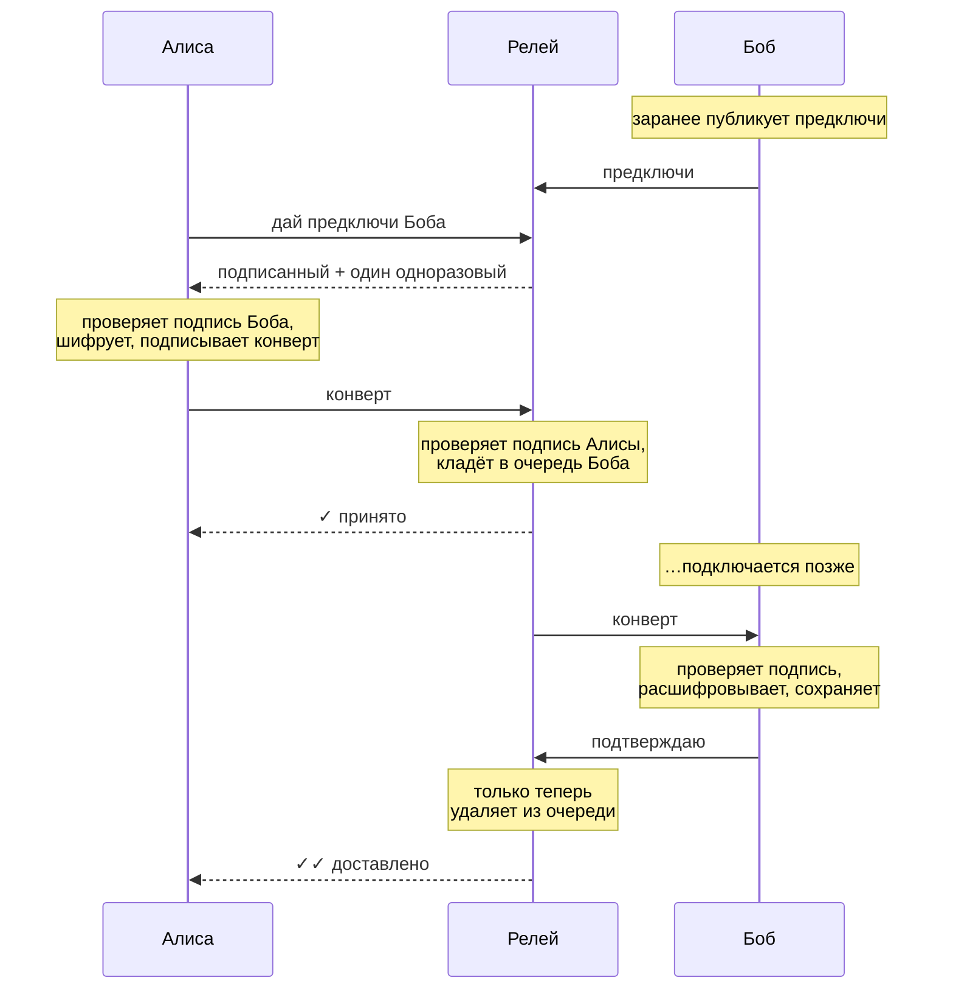

# messanger

Маленькое ядро мессенджера со сквозным шифрованием, написанное на Rust.

Идея простая: **сервер не должен уметь читать ваши сообщения.** Он работает как почта,
которая передаёт запечатанные конверты: видит, от кого и кому письмо, но не знает, что внутри.
Всё шифрование происходит на ваших устройствах, а ключи никогда их не покидают.

Сейчас здесь есть всё, на чём держится мессенджер: ключи, шифрование по схеме Signal
(X3DH + Double Ratchet) с прямой секретностью, подписи, зашифрованная паролем локальная
база с историей, несколько устройств на один аккаунт, сервер-релей и консольный клиент,
чтобы всё это пощупать руками.
Красивого интерфейса и мобильного приложения пока нет, но фундамент для них готов и покрыт тестами.

> [!WARNING]
> **Это экспериментальный проект.** Криптография собрана из хорошо изученных примитивов
> (X25519, Ed25519, ChaCha20-Poly1305) по открытым спецификациям Signal, но наша реализация
> не проходила независимый аудит.
> Пожалуйста, не доверяйте ему ничего, из-за чего у вас могут быть настоящие неприятности.
> Ниже честно написано, [от чего он защищает, а от чего нет](#что-защищено-а-что-нет).

---

## Попробовать за пять минут

Понадобится Rust 1.85 или новее ([установить](https://rustup.rs)), а также компилятор C
и Perl: при первой сборке из исходников собирается OpenSSL для шифрования базы. На Linux и
macOS они обычно уже есть; первая сборка займёт пару минут.

```sh
git clone https://github.com/Paustovskiy/messanger.git
cd messanger
cargo build --release
```

Получатся две программы в `target/release/`:

- `messenger-relay` — сервер, который передаёт сообщения;
- `messenger` — клиент.

Устроим переписку Алисы и Боба на одном компьютере. Каждому нужен свой **профиль** —
это отдельная база со своими ключами.

**Терминал 1 — запускаем релей:**

```sh
./target/release/messenger-relay
```

**Терминал 2 — Алиса:**

```sh
alias alice='./target/release/messenger --profile alice'

alice init
alice set-username alice
alice export-contact -o alice.json
```

```
Придумайте пароль для базы. Без него восстановить данные будет невозможно — запомните его.
Пароль:
Ещё раз:
Создана новая личность для профиля `alice`.
account_id: 0d71b6a2e1e5797b69fd141e4ac49274
отпечаток:  89b1 8cf9 50f2 050c 5b20 2e44 6d84 14c0 bf1d ac08
```

Вся база профиля (ключи, контакты, история) **шифруется этим паролем**. Дальше клиент
будет спрашивать его при каждом запуске. Чтобы не вводить пароль в каждой команде во
время экспериментов, его можно один раз задать в терминале:
`export MESSENGER_PASSWORD='…'`. Для настоящего использования лучше вводить с клавиатуры.

**Терминал 3 — Боб:** то же самое.

```sh
alias bob='./target/release/messenger --profile bob'

bob init
bob set-username bobby
bob export-contact -o bob.json
```

### Знакомимся

Чтобы написать человеку, нужна его **карточка контакта**: небольшой JSON с публичными ключами.
Она не секретная, её можно переслать чем угодно.

```sh
alice add-contact --contact-file bob.json
bob add-contact --contact-file alice.json
```

```
Контакт сохранён: @bobby
отпечаток: 2b1a fd62 a84d 6d8f 7a2c 3e4d cc98 be9c 260d 1a5c
Сверьте его с тем, что собеседник видит в `messenger whoami` (голосом или при встрече).
```

Тот самый **отпечаток** — главное, что стоит проверить. Если он совпадает с тем,
что Боб видит у себя в `bob whoami`, значит, карточку по дороге никто не подменил.
Это как сверить номер паспорта: занимает десять секунд, но без этого остальная защита
держится на честном слове.

### Переписываемся

Боб пока не в сети. Алиса всё равно пишет:

```sh
alice send @bobby "Привет! Ты тут?"
```

```
✓  отправлено: @bobby
   собеседник не в сети — релей доставит, как только он подключится
```

Боб выходит в сеть и сразу получает то, что его ждало:

```sh
bob listen
```

```
В сети как @bobby (ws://127.0.0.1:8080/ws). Ctrl+C — выйти.
[12:39] @alice: Привет! Ты тут?
```

Теперь, когда Боб онлайн, сообщения доходят мгновенно, а Алиса видит две галочки:

```sh
alice send @bobby "Вижу, что дошло 🙂"
```

```
✓✓ доставлено @bobby: «Привет! Ты тут?»
✓  отправлено: @bobby
✓✓ доставлено @bobby: «Вижу, что дошло 🙂»
```

История и список диалогов:

```sh
alice chat @bobby
bob threads
```

```
[2026-10-21 12:39] я ✓✓: Привет! Ты тут?
[2026-10-21 12:39] я ✓✓: Вижу, что дошло 🙂

[2026-10-21 12:39] @alice (2 новых) — Вижу, что дошло 🙂
```

Галочки значат то же, что и везде: **✓** — сообщение принято сервером,
**✓✓** — собеседник получил его и сохранил у себя.

### Подключаем второе устройство

Допустим, у Боба есть ещё телефон (здесь — ещё один профиль). Подключение — три шага,
данные между устройствами Боб переносит сам: копированием или файлом.

**На новом устройстве** — получаем код:

```sh
alias phone='./target/release/messenger --profile bob-phone'
phone link --name телефон
```

```
mlink1.eyJuYW1lIjoi0YLQtdC70LXRhNC-0L0iLCJ4MjU1MTlfcHViX2I2NCI6…

Отпечаток этого устройства: 68d9 3411 f9db 199a db4d c4f6 c9d3 53b6 fed4 e99f
```

**На основном устройстве** — разрешаем, сверив отпечаток:

```sh
bob link-approve mlink1.eyJuYW1l… -o link.json
```

```
Новое устройство «телефон»
отпечаток: 68d9 3411 f9db 199a db4d c4f6 c9d3 53b6 fed4 e99f
Он совпадает с тем, что показало новое устройство? [y/N] y
Список устройств опубликован на релее.

Устройство «телефон» добавлено как №2.
```

**Снова на новом** — завершаем:

```sh
phone link-finish --response-file link.json
phone listen
```

```
Готово: это устройство №2 аккаунта 3402cf24a95cb7cc49aae4e5291994be.
отпечаток аккаунта: a46e 60c0 2520 75e7 f3cd 8847 2626 986c f64a 49a6
Сверьте его с `messenger whoami` на основном устройстве.
Перенесено контактов: 1.
```

Теперь сообщения Алисы приходят на оба устройства, а то, что Боб пишет с телефона,
появляется и на ноутбуке:

```
✓  отправлено: @bobby (устройств: 2)          ← у Алисы

[18:03] @alice: привет обоим                     ← на обоих устройствах Боба
[18:03] я → @alice (с другого устройства): ответ с телефона   ← на ноутбуке
```

Потеряли телефон — отключите его с основного устройства, и релей больше его не пустит:

```sh
bob devices
bob unlink 2   # спросит подтверждение; --yes — без вопроса
```

---

## Как это работает, простыми словами

### Ключи

При `init` клиент создаёт две постоянные пары ключей:

- **ключ личности (X25519)** — участвует в «рукопожатии», когда с вами начинают переписку;
- **ключ подписи (Ed25519)** — им вы «расписываетесь» под карточкой и сообщениями,
  чтобы никто не мог писать от вашего имени.

Ваш `account_id` не случайный: он вычисляется из ключа подписи. Это пригодится чуть ниже.

Кроме них, клиент держит запас **предключей**: один подписанный (меняется раз в неделю)
и пачку одноразовых. Публичные половинки лежат на релее, чтобы вам могли написать,
даже когда вы офлайн. Секретные половинки всех ключей остаются только в вашей локальной базе.

### Знакомство и переписка

Когда Алиса впервые пишет Бобу, её клиент берёт у релея предключи Боба, проверяет, что
они подписаны именно Бобом, и вычисляет общий секрет (это **X3DH**). Одноразовый предключ
выдаётся только одной Алисе и сразу стирается и с релея, и потом у Боба.

Дальше включается **Double Ratchet** — «храповик». Каждое сообщение шифруется своим
собственным ключом, который сразу после использования стирается. А при каждой смене
говорящего стороны подмешивают в секрет новую случайность.

Что это даёт на практике:

- **украли ключи сегодня — вчерашнюю переписку всё равно не прочитать**: ключей от неё уже нет;
- **украли ключи и затаились — это ненадолго**: после одного-двух обменов репликами
  храповик «проворачивается», и украденное перестаёт помогать.

### Путь одного сообщения



Отправитель, получатель и все служебные поля «вшиты» в шифр: если кто-то попробует
переписать что-то на конверте, письмо просто перестанет открываться.

Если Боб ещё ни разу не подключался к релею, Алиса начнёт переписку по предключу из его
карточки. По нему же работает и обмен конвертами вообще без релея (`send --offline` / `receive`).

### Сообщения не теряются

Релей хранит сообщение на диске, пока получатель **не подтвердит**, что сохранил его у себя.
Отвалился интернет на середине доставки, перезапустили сервер — не беда: при следующем
подключении письмо придёт снова. А клиент узнаёт уже полученные сообщения по их идентификатору
и не показывает их дважды.

Исходящее сообщение тоже сначала сохраняется у вас, и только потом уходит в сеть.
Если релей недоступен, оно подождёт в «исходящих» и уйдёт при следующем `listen`
или `sync`.

Можно держать `listen` в одном терминале и писать через `send` из другого: оба процесса
работают с одной базой, и состояние храповика от этого не разъезжается.

### Никто не зайдёт под вашим именем

Когда клиент подключается к релею, тот присылает случайное число, а клиент подписывает его
своим ключом. Так как `account_id` вычислен из этого же ключа, релей сразу видит, что ID и ключ
подходят друг к другу. Поэтому прочитать вашу очередь сообщений, просто назвавшись вами,
не получится, даже если вы ещё ни разу не подключались.

### Несколько устройств

Ключи с устройства на устройство не копируются. У каждого устройства свои ключи, свои
предключи и свои сессии, а связывает их **список устройств**, подписанный ключом аккаунта.
Ключ аккаунта — это ключ основного устройства (того, где делали `init`), поэтому только оно
может подключать и отключать устройства и выдавать карточку контакта.

Когда Алиса пишет Бобу, её клиент берёт у релея свежий список устройств Боба, **сам**
проверяет подпись и шифрует сообщение отдельно для каждого устройства. Копию себе на
остальные свои устройства клиент тоже отправляет — так вся переписка видна везде.

Релей пускает только устройства из последнего списка и не может «вернуть» отключённое:
у списка есть версия, и клиенты не принимают версию старше уже виденной.

Чего пока нет: история, накопленная до подключения, на новое устройство не переносится,
а контакты переносятся один раз, при подключении. Контакт, добавленный позже, нужно
добавить на каждом устройстве.

Если хочется подробностей вплоть до байтов, загляните в [`docs/PROTOCOL.md`](docs/PROTOCOL.md).

---

## Что защищено, а что нет

Честный список, без маркетинга.

| Ситуация | Что будет |
|---|---|
| Сервер или кто-то в сети хочет прочитать переписку | ✅ **Не выйдет.** Текст зашифрован на устройстве отправителя |
| Кто-то подменил текст сообщения по дороге | ✅ **Заметим.** Подпись не сойдётся, и сообщение будет отброшено |
| Кто-то пишет вам от имени Алисы | ✅ **Не выйдет** без секретного ключа Алисы |
| Кто-то подключается к релею под вашим ID, чтобы забрать вашу почту | ✅ **Не пустят.** Нужна подпись вашим ключом |
| Чужая карточка с тем же `@username`, что у вашего контакта | ✅ **Не примем.** Username не может перейти к другому аккаунту молча |
| Кто-то подменил карточку при первом обмене | ⚠️ **Спасает только сверка отпечатков.** Не пропускайте её |
| Сервер видит, **кто, кому и когда** пишет, и примерный размер писем | ⚠️ **Да, видит.** Это метаданные, их почтальон знает всегда |
| Сеть видит то же самое, плюс ваш ID | ⚠️ Если подключаться по `ws://`. **Используйте `wss://`** (см. ниже) |
| Ваши ключи украли, а у вора была запись старой переписки из сети | ✅ **Не прочитает.** Ключей от старых сообщений уже не существует |
| Ключи украли и продолжают подслушивать | ✅ **Ненадолго.** После обмена репликами храповик обновляет секрет, и украденное перестаёт работать |
| Кто-то перехватил и повторно прислал старое сообщение | ✅ **Отбросим.** Дубли и повторы распознаются |
| Релей подсунул свои предключи вместо предключей собеседника | ✅ **Заметим.** Предключи проверяются по ключу подписи из вашего списка контактов |
| Релей «добавил» собеседнику своё устройство, чтобы читать копии | ✅ **Не выйдет.** Список устройств подписан ключом аккаунта собеседника, клиент проверяет подпись сам |
| Потеряли телефон с подключённым аккаунтом | ✅ **`unlink` с основного устройства:** релей закроет его соединения и больше не пустит, собеседники перестанут ему писать. Прочитанное до этого на телефоне остаётся там — поэтому и там нужен пароль базы |
| Потеряли основное устройство | ⚠️ **Ключ аккаунта остался только на нём.** Остальные устройства продолжат работать, но подключать новые станет нечем. Резервной копии ключа пока нет |
| Украли компьютер или бэкап | ✅ **Без пароля ничего не прочитать.** Вся база зашифрована (SQLCipher), ключ из пароля получается через Argon2id, чтобы перебор был дорогим. Но слабый пароль подобрать можно — берите длинный |
| На компьютере работает шпионская программа, пока клиент запущен | ❌ **Не защищает.** Запущенный клиент держит ключи в памяти, а пароль вводится с клавиатуры |
| Сервер «теряет» или задерживает сообщения | ⚠️ Помешать нельзя, но **вы это увидите:** вторая галочка не появится |

---

## Все команды

| Команда | Что делает |
|---|---|
| `init` | Создать свою личность (один раз на профиль). Спросит пароль для базы; `--no-password` — без шифрования (не рекомендуется) |
| `set-password` | Зашифровать базу паролем или сменить пароль. `listen` на это время нужно остановить |
| `remove-password` | Снять пароль с базы |
| `whoami` | Показать свой ID, username, отпечаток и номер этого устройства |
| `set-username <имя>` | Задать `@username`: 5–32 символа `a–z`, `0–9`, `_`, начинается с буквы |
| `export-contact [-o файл]` | Выгрузить свою карточку контакта (только на основном устройстве) |
| `add-contact` | Добавить собеседника: `--contact '<json>'`, `--contact-file <путь>` или через stdin |
| `list-contacts` | Контакты с их отпечатками |
| `remove-contact <кто>` | Удалить контакт |
| `send <кому> <текст>` | Отправить через релей. `--offline` вместо этого выведет зашифрованный конверт |
| `receive` | Открыть конверт, полученный в обход релея (например, по почте или на флешке) |
| `listen` | Быть в сети: получать сообщения, досылать исходящие, переподключаться при обрыве |
| `sync` | Подключиться один раз: забрать всё, что ждёт на релее, дослать исходящие и выйти |
| `chat <с кем>` | История переписки |
| `threads` | Список диалогов с непрочитанными |
| `devices` | Устройства аккаунта с их отпечатками |
| `link [--name имя]` | На новом устройстве (в новом профиле): выдать код подключения |
| `link-approve <код> [-o файл]` | На устройстве с ключом аккаунта: подключить новое, сверив отпечаток (`--yes` — не спрашивать). Нужен релей: список сначала публикуется, потом сохраняется |
| `link-finish` | На новом устройстве: завершить подключение по ответу: `--response '<json>'`, `--response-file <путь>` или через stdin |
| `unlink <номер> [--yes]` | На устройстве с ключом аккаунта: отключить другое устройство (себя и №1 нельзя). Нужен релей; спрашивает подтверждение, без терминала нужен `--yes` |

«Кому» и «с кем» можно указывать как `@username` (собачку можно опустить) или как `account_id`.

### Настройки

| Параметр | Переменная окружения | По умолчанию |
|---|---|---|
| `--profile <имя>` | `MESSENGER_PROFILE` | `messenger` |
| `--relay <url>` | `MESSENGER_RELAY` | `ws://127.0.0.1:8080/ws` |
| `--db <путь>` | `MESSENGER_DB` | каталог данных ОС, например `~/.local/share/<профиль>/` |
| — | `MESSENGER_PASSWORD` | пароль от базы (для скриптов; иначе спросит) |
| — | `MESSENGER_NEW_PASSWORD` | новый пароль для `set-password` (для скриптов) |

Например, чтобы не писать адрес релея каждый раз:

```sh
export MESSENGER_RELAY=wss://chat.example.com/ws
```

---

## Свой релей на сервере

Релей — одна программа без внешних зависимостей. Всё состояние живёт в одном файле SQLite.

```sh
messenger-relay --bind 127.0.0.1:8080 --db /var/lib/messenger/relay.sqlite
```

| Флаг | Смысл | По умолчанию |
|---|---|---|
| `--bind` | Адрес и порт (`RELAY_BIND`) | `127.0.0.1:8080` |
| `--db` | Файл базы (`RELAY_DB`) | `relay.sqlite` |
| `--in-memory` | Ничего не сохранять на диск (для экспериментов) | выкл. |
| `--ttl-days` | Сколько дней хранить недоставленные сообщения | `30` |
| `--max-queue` | Сколько сообщений может ждать одно устройство получателя | `1000` |
| `--connections-per-ip-per-minute` | Новых подключений в минуту с одного IP | `60` |
| `--sends-per-minute` | Сообщений в минуту от одного аккаунта | `120` |
| `--one-time-prekeys-per-hour` | Сколько одноразовых предключей одного человека релей раздаёт за час | `50` |
| `--trust-forwarded-for` | Брать адрес клиента из `X-Forwarded-For` (`RELAY_TRUST_FORWARDED_FOR`) | выкл. |

**Лимиты.** Релей защищается от флуда: сверх лимитов он отвечает «rate limited», а на
слишком частые подключения — HTTP 429. Ещё он ограничивает число одновременных соединений
одного устройства (10) и сообщений в одном соединении (600 в минуту).
Особый случай — одноразовые предключи. Аккаунты бесплатные, поэтому злоумышленник мог бы
завести их сотню и «выкачать» все ваши одноразовые ключи. Релей раздаёт их ограниченно:
лимит есть и на получателя, и на запрашивающего. Сверх лимита собеседник получает
только подписанный предключ. Переписка от этого не ломается, просто первое сообщение
обходится без дополнительной защиты одноразовым ключом.

Подробность логов — через `RUST_LOG`, например `RUST_LOG=debug`. В логи попадают только
ID аккаунтов, содержимое сообщений релей не видит в принципе.
По `SIGTERM` и Ctrl+C релей завершается аккуратно, так что подходит для systemd и Docker.
Для проверки «жив ли» есть `GET /health`.

**Про TLS.** Сам релей шифрованное соединение не поднимает: эту работу лучше отдать
обратному прокси. Проще всего с [Caddy](https://caddyserver.com), он сам получит сертификат:

```
chat.example.com {
    reverse_proxy 127.0.0.1:8080
}
```

После этого клиенты подключаются через `--relay wss://chat.example.com/ws`.

За прокси все подключения приходят с одного адреса, поэтому запускайте релей с
`--trust-forwarded-for`: тогда лимит по IP считается по настоящему адресу клиента.
Включайте этот флаг **только** за своим прокси. Иначе клиент сам впишет в заголовок
любой адрес и обойдёт лимит.

---

## Как устроен код

```
crates/
├── protocol/       форматы данных: конверт, карточка, сообщения релея.
│                   Без криптографии — только структуры и байтовые представления
├── crypto_core/    ключи, подписи, X3DH и Double Ratchet
├── storage/        локальная база клиента (SQLCipher) с миграциями и шифрованием паролем
├── relay_server/   сервер-релей (axum + WebSocket + SQLite)
└── cli/            консольный клиент `messenger`
```

Слои зависят только «вниз»: `protocol` ничего не знает о криптографии, `crypto_core` ничего
не знает о базе, а `storage` — о сети. Поэтому будущий графический или мобильный клиент
сможет взять `protocol` + `crypto_core` + `storage` как есть и заменить только интерфейс.

### Разработка

```sh
cargo test --workspace     # все тесты, около 120 штук
cargo clippy --workspace --all-targets
cargo fmt --all
```

Что проверяют тесты:

- **crypto_core:** долгая переписка, сообщения не по порядку и потерянные, повтор первого
  сообщения, повторно использованный одноразовый ключ, подменённый релеем предключ,
  одновременный старт с обеих сторон, потеря состояния собеседником, «лечение» после кражи
  ключей, подмена текста и отправителя; отдельные сессии с каждым устройством, подмена
  номера устройства, поддельные и чужие списки устройств, откат списка;
- **protocol:** форматы, версии, лимиты, совместимость подписи карточек со старым форматом;
- **storage:** свежая база, миграции со всех прошлых версий схемы (включая перенос сессий
  на устройство №1), исходящие по конвертам на каждое устройство, дубли, права на файл,
  откат транзакций и четыре потока, одновременно пишущие в одну базу; шифрование — что на
  диске (включая журнал) нет ни строчки открытого текста, неверный пароль, смена и снятие
  пароля без потери данных, отказ перешифровывать базу, открытую другим процессом;
- **relay_server:** реальный сервер на случайном порту — вход, попытка войти под чужим ID,
  офлайн-очередь, подтверждения, поддельные конверты и `ack`, несколько соединений одного
  аккаунта, пинги, выдача предключей, переживание перезапуска, а также атаки на лимиты:
  «выкачивание» предключей с множества аккаунтов, флуд сообщениями и подключениями,
  подделка `X-Forwarded-For`; устройства — вход только по подписанному списку, отдельные
  очереди и подтверждения, отказ в откате списка, отключение устройства на лету;
- **cli:** сквозные сценарии из настоящих процессов `messenger` и релея, включая `listen`
  и `send` одного пользователя, работающие одновременно, полный цикл пароля от базы и
  подключение второго устройства: переписка с двух устройств и отключение.

На каждый push GitHub Actions прогоняет fmt, clippy и тесты на Linux, macOS и Windows,
а также проверяет сборку на минимальной поддерживаемой версии Rust.

---

## Если у вас база от прошлой версии

Всё обновится само при первом запуске. Но есть несколько моментов:

- **Протокол поменялся** (конверт v3: у каждого устройства свои сессии), так что клиенты
  и релей нужно обновить вместе. Новый релей при первом запуске очищает старую очередь —
  её всё равно не открыть новым клиентом. Привязки аккаунтов к ключам сохраняются.
- **Переписка продолжается с того же места:** сессии с собеседниками переезжают на их
  устройство №1, заново знакомиться не нужно.
- Сообщения, которые к обновлению не успели подтвердиться, в `chat` помечены ✗.
  Часть из них могла дойти (подтверждение просто не успело вернуться), но проверить это
  уже нельзя — если важно, отправьте заново. Вся история при этом сохраняется.
- Ваше устройство становится основным (№1) — список устройств аккаунта заводится сам.
  Свежая карточка (`export-contact`) теперь содержит и его, но и со старыми карточками
  всё работает: список собеседники берут у релея.
- **Если база ещё не зашифрована** — клиент будет об этом напоминать. Зашифровать её:
  `messenger set-password` (остановите на это время `listen`). Данные сохранятся.
- Если ваша личность создавалась ещё **без ключа подписи**, клиент сгенерирует его и предупредит.
- Старые аккаунты с ID вида UUID продолжают работать, но для них релей может опереться только
  на «первый вход»: кто первым зашёл под этим ID, за тем он и закреплён. Если хочется полной защиты,
  проще всего завести новый профиль (`--profile`) — у него ID будет вычислен из ключа.
- Контакты, добавленные совсем старой версией, хранятся без ключа подписи, и переписываться
  с ними нельзя. В `list-contacts` они помечены ⚠ — попросите у них карточку заново.

---

## Что дальше

Вот что хочется сделать, примерно в порядке важности:

- [x] **Прямая секретность** (X3DH + Double Ratchet, как в Signal)
- [x] Шифрование локальной базы паролем
- [x] Несколько устройств на один аккаунт
- [ ] Перенос истории и контактов между устройствами, резервная копия ключа аккаунта
- [ ] Группы
- [ ] Вложения: файлы и картинки
- [x] Ограничение частоты запросов на релее
- [ ] Графический или мобильный клиент поверх готовых крейтов

Если хочется помочь с чем-то из списка или просто нашли ошибку, issues и pull request'ы очень ждём.

## Лицензия

Пока не выбрана.
